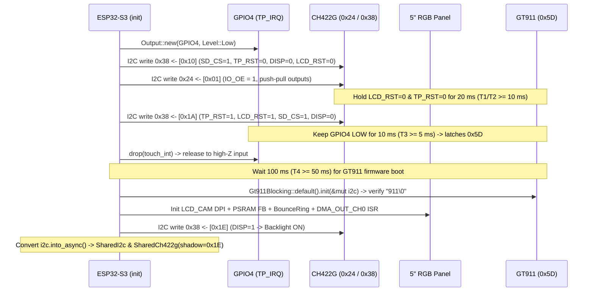

# Design & Implementation Plan: Porting `ws-esp32-s3-touch-lcd-2-8c` → `ws-esp32-s3-touch-lcd-5`

> **Target Hardware:** Waveshare **ESP32-S3-Touch-LCD-5** (Rev 1.2, 5.0" 800×480 RGB565 IPS, ESP32-S3-WROOM-1-N16R8, CH422G I/O expander, GT911 touch) — with optional feature-gated support for the **5B (1024×600)** variant.
>
> **Toolchain & HAL Baseline:** `esp-hal = "=1.0.0-rc.0"` (`features = ["esp32s3", "unstable", "psram"]`), `embedded-hal = "1.0"`, `embedded-hal-async = "1.0"`, `esp-hal-embassy = "0.9.1"`, `gt911 = "0.3"`, Rust edition `2024`, `no_std`.

---

## Table of Contents

1. [Current Repository Audit](#1-current-repository-audit)
2. [Conflicts & Resolutions (2.8C → 5-inch Rev 1.2)](#2-conflicts--resolutions-28c--5-inch-rev-12)
3. [Workspace & `Cargo.toml` Migration](#3-workspace--cargotoml-migration)
4. [CH422G Minimal `no_std` Driver & Reset Sequence Spec](#4-ch422g-minimal-no_std-driver--reset-sequence-spec)
5. [DPI Peripheral & Bounce-Buffer Sizing Analysis](#5-dpi-peripheral--bounce-buffer-sizing-analysis)
6. [Boot Strapping & Hardware Gotchas](#6-boot-strapping--hardware-gotchas)
7. [Autonomous Agent Self-Test Harness (`selftest_hw`)](#7-autonomous-agent-self-test-harness-selftest_hw)
8. [Phased Execution & Verification Plan](#8-phased-execution--verification-plan)

---

## 1. Current Repository Audit

The existing workspace (`ESP32-S3-Touch-LCD-2.8C`) contains two crates:
- `crates/st7701`: Pure `no_std` bit-banged 9-bit 3-wire SPI driver (`embedded-hal 1.0`, builds on host `stable`).
- `crates/ws-esp32-s3-touch-lcd-2-8c`: ESP32-S3 BSP crate (`xtensa-esp32s3-none-elf`, `esp` toolchain via `crates/ws-esp32-s3-touch-lcd-2-8c/rust-toolchain.toml`).

### 1.1 Exact `esp-hal 1.0.0-rc.0` APIs in Use

> **Pinning Note:** `esp-hal` is strictly pinned to `=1.0.0-rc.0` because `esp-hal-embassy 0.9.1` relies on the internal `__esp_hal_embassy` feature removed in `esp-hal 1.0.0` stable. All types and signatures below are verified against `esp-hal 1.0.0-rc.0`.

| Subsystem | `esp-hal 1.0.0-rc.0` APIs Used | Current Implementation Details |
| :--- | :--- | :--- |
| **PSRAM Init** | `esp_hal::init(Config::default().with_psram(PsramConfig { size: PsramSize::Size(8 * 1024 * 1024), ..Default::default() }))` | Configured in example `main()`. `.cargo/config.toml` sets `ESP_HAL_CONFIG_PSRAM_MODE = "octal"` (mandatory — default `"quad"` silently breaks PSRAM cache writebacks). |
| **PSRAM Mapping & Heap** | `esp_hal::psram::psram_raw_parts(&r.psram) -> (*mut u8, usize)` | `Framebuffer::split_from_psram` carves two contiguous framebuffers (`2 * BYTES`) from the start of mapped PSRAM directly (not via `esp-alloc`). Examples allocate a separate 64 KiB internal DRAM heap (`esp_alloc::heap_allocator!(size: 64 * 1024)`). |
| **D-Cache Writeback** | ROM FFI: `Cache_Suspend_DCache_Autoload`, `rom_Cache_WriteBack_Addr`, `Cache_Resume_DCache_Autoload` | Called in `Framebuffer::write_row`, `draw_row_solid`, `draw_column`, and `fill_buffer` so CPU writes in L1 D-cache are committed to physical PSRAM before the bounce-buffer ISR reads them. |
| **I²C Master** | `esp_hal::i2c::master::{I2c, Config as I2cConfig}`, `Rate::from_khz(400)`, `i2c.into_async()` | Starts blocking (`I2c<'static, Blocking>`) for synchronous boot init (PCA9554 + GT911), then converts via `.into_async()` into `Mutex<CriticalSectionRawMutex, I2c<'static, Async>>` inside a `StaticCell` (`SharedI2c`). Consumers wrap it with `embassy_embedded_hal::shared_bus::asynch::i2c::I2cDevice`. |
| **LCD_CAM / DPI** | `LcdCam::new(r.lcd_cam)`, `Dpi::new(lcd_cam.lcd, r.dma_ch0, dpi_config)`, `DpiConfig`, `ClockMode`, `Polarity`, `Phase`, `Format`, `FrameTiming`, `.with_vsync/hsync/de/pclk/data0..15(...)`, `dpi.send(true, bounce)` | `Dpi::send(true, bounce)` enables `lcd_next_frame_en` for continuous looping; the returned `DpiTransfer` is intentionally leaked via `core::mem::forget(transfer)`. |
| **GDMA Bounce Ring & EOF ISR** | `esp_hal::dma::{DmaTxBuffer, DmaDescriptor, Owner, Preparation, TransferDirection, BurstConfig}`, `esp_hal::interrupt::{bind_interrupt, enable, Priority}`, `Interrupt::DMA_OUT_CH0`, `esp_hal::peripherals::DMA::PTR` | Custom `BounceRing` implements `unsafe impl DmaTxBuffer` with `accesses_psram: false`, `check_owner: Some(false)`, `auto_write_back: false`. Two 64-byte-aligned DRAM buffers (`BOUNCE_A`, `BOUNCE_B`) are referenced in a closed frame-sized descriptor ring with `suc_eof = true` on the last descriptor of each half. |

### 1.2 Current Bounce-Buffer & Double-Buffer Architecture

Direct PSRAM→DPI DMA on ESP32-S3 causes diagonal drift artefacts triggered by PSRAM refresh cycles at any PCLK. The existing crate solves this cleanly and **should be preserved verbatim in structure**:

1. **Two DRAM bounce halves** (`BOUNCE_A`, `BOUNCE_B`, `#[repr(align(64))]`), each holding `N_LINES_PER_HALF` scanlines.
2. **Closed frame-sized GDMA descriptor ring** (`N_DESC = DESC_PER_HALF * HALVES_PER_FRAME`, chunk size `4032` bytes = 64-byte-aligned max under 4095). Even halves point to `BOUNCE_A`, odd halves point to `BOUNCE_B`. Requires `HALVES_PER_FRAME` to be **even** and divide `HEIGHT` cleanly.
3. **Hardware-derived half index in `eof_isr`:** Reads `dma.ch(0).out_eof_des_addr()` at `Priority::Priority2` to determine which descriptor just finished — immune to coalesced-EOF counter drift.
4. **Tear-free double-buffer swap:** `Framebuffer::flip()` stores the new front pointer into `PENDING_SWAP`; `eof_isr` atomically consumes `PENDING_SWAP` when `next_chunk == 0`, updating `PSRAM_FB_PTR` right before refilling chunks 0 and 1 of the next frame.

---

## 2. Conflicts & Resolutions (2.8C → 5-inch Rev 1.2)

> [!WARNING]
> **Conflicts & Resolutions:** The following hardware and API differences between `ws-esp32-s3-touch-lcd-2-8c` and the target **ESP32-S3-Touch-LCD-5 (Rev 1.2)** must be resolved explicitly rather than inherited.

| # | Conflict Area | Existing 2.8C Crate | Target 5-inch Rev 1.2 | Resolution |
| :-: | :--- | :--- | :--- | :--- |
| 1 | **Panel Init Bus** | Sitronix ST7701 requires 9-bit 3-wire SPI init on `GPIO1`/`GPIO2` + PCA9554 CS/RST. | ST7262-class sync-only RGB panel; **no SPI init**. `GPIO1`/`GPIO2` are now RGB `R3`/`R4`. | Remove `crates/st7701`, `UnwrapPin`, and SPI bit-bang code completely. Only toggle `LCD_RST` via CH422G `EXIO3`. |
| 2 | **I²C0 Pins** | `SDA = GPIO15`, `SCL = GPIO7`. | `SDA = GPIO8`, `SCL = GPIO9` (`GPIO7` is now `PCLK`, `GPIO15` is unused by DPI). | Remap `Resources.sda` to `GPIO8`, `Resources.scl` to `GPIO9`, and update `consts::i2c`. |
| 3 | **I/O Expander Protocol** | `PCA9554` at single 7-bit address `0x20` with readable OutputPort (`0x01`) and Config (`0x03`) registers; stateless hardware RMW. | `CH422G` uses **multi-address write-only** single-byte commands (`0x24` `WR_SET`, `0x38` `WR_IO`). Cannot read back output latch in output mode. | Replace `port-expander` and `pca9554.rs` with new `crates/ch422g` maintaining a **software shadow byte** (`io_state: u8`) protected by a single `SharedCh422g` mutex. |
| 4 | **Backlight Control** | Direct ESP32-S3 `GPIO6` (`Output<'static>`), synchronous `on()`/`off()`, PWM-capable via `into_inner()`. | `DISP` routed through CH422G `EXIO2` (bit 2, active high). | Change `Backlight` to hold `&'static SharedCh422g` with `async fn on/off/set`. Remove `into_inner()` (LEDC PWM is not possible through CH422G). |
| 5 | **Touch Interrupt Pin** | `touch_int = GPIO16`; `GPIO4` is `battery_adc`. | `TP_IRQ = GPIO4` (active during `TP_RST` rising edge for GT911 address strapping). | Remap `Resources.touch_int` to `GPIO4`; remove `battery_adc` from `Resources`/`Board`. |
| 6 | **Removed On-Board Peripherals** | On-board piezo buzzer (PCA9554 bit 7), PCF85063A RTC (`0x51`), QMI8658 IMU (`0x6B`), SD pins (`GPIO1`/`2`/`42`). | None of buzzer/RTC/IMU exist on 5-inch Rev 1.2. `GPIO1`/`2`/`42` are RGB Red pins (`R3`/`R4`/`R5`). | Remove `buzzer.rs`, `rtc.rs`, `imu.rs`, `SdPins` (2.8C layout), and optional `rtc`/`imu` Cargo features. Document `EXIO4` (`SD_CS`) and `EXIO5` (`USB_SEL`) on `Expander` / `consts::ch422g`. |
| 7 | **`esp-hal` `FrameTiming` Field Semantics** | Standard datasheets specify `HSYNC pulse`, `HBP`, `HFP`. | `esp-hal 1.0.0-rc.0` `FrameTiming::horizontal_blank_front_porch` is **start-of-line to start-of-active** (`hsync_width + hbp`), **not** datasheet `HFP`! Same for `vertical_blank_front_porch` (`vsync_width + vbp`). | Set `horizontal_blank_front_porch = 4 + 8 = 12`, `horizontal_total_width = 4 + 8 + 800 + 8 = 820`, `vertical_blank_front_porch = 4 + 8 = 12`, `vertical_total_height = 4 + 8 + 480 + 8 = 500`. |
| 8 | **Bounce-Buffer Startup Line Shift** | `STARTUP_OFFSET_LINES = 6` empirically tuned for 480×480 @ 12 MHz. | Different resolution (800×480) and PCLK (16–20 MHz) change the `Dpi::send` DMA/LCD_CAM startup race. | Reset `STARTUP_OFFSET_HALVES = 0` and `STARTUP_OFFSET_LINES = 0` initially; re-calibrate empirically in Milestone 2 using a 1-px border pattern. |
| 9 | **5B (`1024×600`) Bounce Divisibility** | `N_LINES_PER_HALF = 16` divides `480` evenly (`30` halves, even). | `600 % 16 != 0` — compile-time `assert!(framebuffer::BYTES % HALF_BYTES == 0)` would fail for 5B! | Gate `N_LINES_PER_HALF` by panel feature: `16` for `800×480` (`30` halves, even), `10` for `1024×600` (`60` halves, even). |

---

## 3. Workspace & `Cargo.toml` Migration

### 3.1 Proposed Workspace Layout

```text
.
├── Cargo.toml                            # Workspace root (members: ch422g, ws-esp32-s3-touch-lcd-5)
├── rust-toolchain.toml                   # Host default: stable (builds & tests crates/ch422g)
├── PORTING_PLAN.md                       # This document
└── crates/
    ├── ch422g/                           # NEW: pure no_std CH422G driver (embedded-hal 1.0 + optional async)
    │   ├── Cargo.toml
    │   └── src/
    │       └── lib.rs
    └── ws-esp32-s3-touch-lcd-5/          # REPLACES crates/ws-esp32-s3-touch-lcd-2-8c
        ├── .cargo/config.toml            # xtensa-esp32s3-none-elf, build-std, ESP_HAL_CONFIG_PSRAM_MODE="octal"
        ├── rust-toolchain.toml           # channel = "esp"
        ├── Cargo.toml
        ├── examples/
        │   ├── selftest_hw.rs            # Autonomous HIL self-test (PSRAM, CH422G, GT911, DPI regs, ISR, flip)
        │   ├── hello_backlight.rs        # Milestone 2: CH422G + solid RGB fill (visual gate)
        │   ├── hello_pattern.rs          # Milestone 3: border/grid timing & offset test (visual gate)
        │   └── hello_touch.rs            # Milestone 4: 800x480 GT911 crosshair demo (interactive gate)
        └── src/
            ├── lib.rs                    # Resources, DpiDataPins, take_resources!, Board, init(), Error
            ├── consts.rs                 # Pinouts, I2C addrs, CH422G bitmasks, DPI timings
            ├── expander.rs               # SharedCh422g mutex wrapper (EXIO1..EXIO5)
            ├── backlight.rs              # Async Backlight handle via SharedCh422g EXIO2
            ├── framebuffer.rs            # 800x480 (or 1024x600) double-buffered PSRAM framebuffer
            ├── bounce_buffer.rs          # DRAM BounceRing + DMA_OUT_CH0 EOF ISR
            ├── shared_bus.rs             # SharedI2c + BoardI2cDevice (unchanged pattern)
            └── touch.rs                  # TouchPoller (gt911 async wrapper, unchanged pattern)
```

> **Removed:** `crates/st7701/`, `src/pca9554.rs`, `src/buzzer.rs`, `src/rtc.rs`, `src/imu.rs`, and `examples/hello_{buzzer,imu,rtc,all}.rs`.

### 3.2 Root `Cargo.toml` Diff

```toml
[workspace]
resolver = "2"
members = [
    "crates/ch422g",
    "crates/ws-esp32-s3-touch-lcd-5",
]
# ch422g is pure no_std + embedded-hal traits and builds/tests on host stable.
default-members = ["crates/ch422g"]

[workspace.package]
version    = "0.1.0"
edition    = "2024"
license    = "MIT"

[workspace.dependencies]
embedded-hal       = "1.0"
embedded-hal-async = "1.0"
```

### 3.3 `crates/ch422g/Cargo.toml`

```toml
[package]
name        = "ch422g"
description = "Minimal no_std driver for the WCH CH422G I2C I/O expander (embedded-hal 1.0 + optional async)."
version.workspace = true
edition.workspace = true
license.workspace = true

[features]
default = []
async   = ["dep:embedded-hal-async"]

[dependencies]
embedded-hal       = { workspace = true }
embedded-hal-async = { workspace = true, optional = true }
```

### 3.4 `crates/ws-esp32-s3-touch-lcd-5/Cargo.toml` Diff

**Removed dependencies:** `st7701`, `port-expander`, `embedded-hal-bus`, `pcf85063a`, `ph-qmi8658`, `time`.
**Added dependencies:** `ch422g = { version = "0.1", path = "../ch422g", features = ["async"] }`.

```toml
[package]
name        = "ws-esp32-s3-touch-lcd-5"
description = "Board-support package for the Waveshare ESP32-S3-Touch-LCD-5 (800x480 / 1024x600 RGB IPS + GT911 + CH422G)."
categories  = ["embedded", "no-std", "hardware-support"]
keywords    = ["esp32", "embedded", "bsp", "waveshare", "rgb-lcd"]
version.workspace = true
edition.workspace = true
license.workspace = true

[lib]
test = false # no_std, xtensa-esp32s3-none-elf only

[features]
default = []
# Override default 800x480 (Rev 1.2) timings & framebuffer dimensions for the 5B 1024x600 panel.
panel-1024x600 = []
# Internal gate for example-only runtime dependencies.
_example-runtime = []

[dependencies]
ch422g               = { version = "0.1", path = "../ch422g", features = ["async"] }
gt911                = { version = "0.3", default-features = false }
embedded-hal         = { workspace = true }
embedded-hal-async   = { workspace = true }
critical-section     = "1"
log                  = "0.4"
embassy-sync         = "0.8"
embassy-embedded-hal = "0.6"
embassy-time         = "0.4"
static_cell          = "2.1"
esp-hal              = { version = "=1.0.0-rc.0", features = ["esp32s3", "unstable", "psram"] }

[dev-dependencies]
esp-hal-embassy        = { version = "0.9.1",  features = ["esp32s3"] }
esp-backtrace          = { version = "0.18.1", features = ["esp32s3", "panic-handler", "println"] }
esp-println            = { version = "0.16.1", features = ["esp32s3", "log-04"] }
esp-bootloader-esp-idf = { version = "0.3",    features = ["esp32s3"] }
esp-alloc              = "0.9"
embassy-executor       = "0.7"
embassy-time           = "0.4"
embedded-graphics      = "0.8"
heapless               = "0.8"
```

> **Cargo Config (`.cargo/config.toml`):** Copy directly from `ws-esp32-s3-touch-lcd-2-8c/.cargo/config.toml`, keeping `target = "xtensa-esp32s3-none-elf"`, `build-std = ["alloc", "core"]`, and **`ESP_HAL_CONFIG_PSRAM_MODE = "octal"`**.

---

## 4. CH422G Minimal `no_std` Driver & Reset Sequence Spec

### 4.1 Hardware Protocol Characteristics

Unlike PCA9554/TCA9554, the WCH **CH422G** does **not** use a single device address with internal register pointers. Each command is a **single-byte I²C write to a dedicated 7-bit I²C address**:

| Function | 7-bit I²C Addr | 8-bit Write Addr | Direction | Payload (1 byte) |
| :--- | :---: | :---: | :---: | :--- |
| **`WR_SET`** (System Parameter) | `0x24` | `0x48` | Write-only | Bit 0 (`IO_OE`): `1` = `EXIO0..7` push-pull output, `0` = input (POR default). Bit 2 (`OD_EN`): `0` = push-pull OC. Bit 3 (`SLEEP`): `0` = active. Normal value: **`0x01`**. |
| **`WR_IO`** (Output Latch `EXIO0..7`) | `0x38` | `0x70` | Write-only | Bit `n` = output level of `EXIO{n}` (`0` = Low, `1` = High). |
| **`RD_IO`** (Input Read `EXIO0..7`) | `0x26` | `0x4D` | Read-only | Reads physical pin levels (valid when `IO_OE = 0`; not a reliable output-latch readback). |

### 4.2 Pin Mapping on Waveshare ESP32-S3-Touch-LCD-5 (Rev 1.2)

| CH422G Pin | Bit | Mask | Signal | Polarity / Safe Idle State |
| :--- | :-: | :---: | :--- | :--- |
| `EXIO1` | 1 | `0x02` | `TP_RST` | Active-low touch reset — keep **`1`** during normal operation. |
| `EXIO2` | 2 | `0x04` | `DISP` | Active-high LCD backlight enable — **`0`** during boot, **`1`** once DPI DMA is running. |
| `EXIO3` | 3 | `0x08` | `LCD_RST` | Active-low LCD reset — keep **`1`** during normal operation. |
| `EXIO4` | 4 | `0x10` | `SD_CS` | Active-low microSD chip-select — keep **`1`** when idle. |
| `EXIO5` | 5 | `0x20` | `USB_SEL` | USB/CAN mux select (`0` = USB, `1` = CAN) — default **`0`**. |

- **Reset-asserted mask (`MASK_RESET_LOW`):** `SD_CS` = `0x10` (`TP_RST=0`, `DISP=0`, `LCD_RST=0`, `SD_CS=1`, `USB_SEL=0`).
- **Idle-released mask (`MASK_IDLE_DARK`):** `TP_RST | LCD_RST | SD_CS` = `0x1A` (backlight off).
- **Normal active mask (`MASK_ACTIVE`):** `TP_RST | DISP | LCD_RST | SD_CS` = `0x1E` (backlight on).

### 4.3 `crates/ch422g` Struct & Trait Bounds

Because `WR_IO` (`0x38`) is write-only, the driver **must own a software shadow register (`io_state: u8`)** and never allow independent uncoordinated instances on the same bus.

```rust
#![no_std]

pub const ADDR_WR_SET: u8 = 0x24;
pub const ADDR_WR_IO:  u8 = 0x38;
pub const ADDR_RD_IO:  u8 = 0x26;

/// System mode byte: IO0..IO7 push-pull outputs enabled, awake.
pub const MODE_OUTPUT_ENABLE: u8 = 0x01;

/// Synchronous CH422G driver (used during BSP boot init).
/// Does not own the I2C bus so boot code can share `&mut I2c` with GT911
/// without needing `RefCellDevice`.
pub struct Ch422g {
    io_state: u8,
}

impl Ch422g {
    /// Create a driver with an initial shadow state (does not touch I2C yet).
    pub const fn new(initial_io: u8) -> Self {
        Self { io_state: initial_io }
    }

    /// Pre-load the output latch (`0x38`) *before* enabling output drivers (`0x24`)
    /// so pins transition from high-Z to their intended level without glitching.
    pub fn init<I2C>(&mut self, i2c: &mut I2C) -> Result<(), I2C::Error>
    where
        I2C: embedded_hal::i2c::I2c,
    {
        i2c.write(ADDR_WR_IO, &[self.io_state])?;
        i2c.write(ADDR_WR_SET, &[MODE_OUTPUT_ENABLE])?;
        Ok(())
    }

    pub fn write_all<I2C>(&mut self, i2c: &mut I2C, value: u8) -> Result<(), I2C::Error>
    where
        I2C: embedded_hal::i2c::I2c,
    {
        i2c.write(ADDR_WR_IO, &[value])?;
        self.io_state = value;
        Ok(())
    }

    pub fn set_pin<I2C>(&mut self, i2c: &mut I2C, bit: u8, high: bool) -> Result<(), I2C::Error>
    where
        I2C: embedded_hal::i2c::I2c,
    {
        debug_assert!(bit < 8);
        let next = if high {
            self.io_state | (1 << bit)
        } else {
            self.io_state & !(1 << bit)
        };
        self.write_all(i2c, next)
    }

    /// Return the current software shadow byte (e.g. to hand off to `Ch422gAsync`).
    pub const fn shadow(&self) -> u8 {
        self.io_state
    }
}
```

For runtime async access (behind `#[cfg(feature = "async")]`):

```rust
pub struct Ch422gAsync<I2C> {
    i2c: I2C,
    io_state: u8,
}

impl<I2C> Ch422gAsync<I2C>
where
    I2C: embedded_hal_async::i2c::I2c,
{
    /// Construct from an already-initialized blocking `Ch422g` shadow byte.
    pub const fn from_shadow(i2c: I2C, io_state: u8) -> Self {
        Self { i2c, io_state }
    }

    pub async fn set_pin(&mut self, bit: u8, high: bool) -> Result<(), I2C::Error> {
        debug_assert!(bit < 8);
        let next = if high {
            self.io_state | (1 << bit)
        } else {
            self.io_state & !(1 << bit)
        };
        self.i2c.write(ADDR_WR_IO, &[next]).await?;
        self.io_state = next;
        Ok(())
    }

    pub const fn shadow(&self) -> u8 {
        self.io_state
    }
}
```

In `crates/ws-esp32-s3-touch-lcd-5/src/expander.rs`, a single `'static` instance is stored in a `StaticCell`:

```rust
pub type SharedCh422g = Mutex<CriticalSectionRawMutex, ch422g::Ch422gAsync<BoardI2cDevice>>;
```

`Backlight` (and any future `SdCs` / `UsbSel` handle) holds `&'static SharedCh422g`, ensuring atomic shadow-register updates across Embassy tasks.

### 4.4 Boot Initialization & Reset Timing Sequence

GT911 address strapping rules (Goodix datasheet):
- `TP_IRQ` (`GPIO4`) **LOW** on the rising edge of `TP_RST` (`EXIO1`) → 7-bit address **`0x5D`** (matches `gt911::Gt911::default()`).
- `TP_IRQ` (`GPIO4`) **HIGH** on the rising edge of `TP_RST` → 7-bit address `0x14`.



> **Why `DISP=1` happens last:** Turning on the backlight only after `dpi.send(true, bounce)` and `enable_eof_interrupt()` are running ensures the panel displays the zeroed black framebuffer immediately instead of flashing uninitialized panel SRAM.

---

## 5. DPI Peripheral & Bounce-Buffer Sizing Analysis

### 5.1 Framebuffer & PSRAM Footprint

| Board / Variant | Resolution | Single FB (`BYTES`) | Double FB (`PSRAM_BYTES_REQUIRED`) | Remaining in 8 MiB Octal PSRAM |
| :--- | :---: | :---: | :---: | :---: |
| 2.8C (Baseline) | 480×480 RGB565 | 460,800 B (450 KiB) | 921,600 B (900 KiB) | ~7.12 MiB |
| **5-inch Rev 1.2 (Default)** | **800×480 RGB565** | **768,000 B (750 KiB)** | **1,536,000 B (1,500 KiB)** | **~6.54 MiB** |
| 5B (`panel-1024x600`) | 1024×600 RGB565 | 1,228,800 B (1,200 KiB) | 2,457,600 B (2,400 KiB) | ~5.66 MiB |

### 5.2 Timing & Bandwidth Math (800×480 Baseline)

From the target specification:
- Horizontal: `active = 800`, `hsync_pulse = 4`, `hbp = 8`, `hfp = 8` → `horizontal_blank_front_porch = 12`, `horizontal_total_width = 820` PCLKs/line.
- Vertical: `active = 480`, `vsync_pulse = 4`, `vbp = 8`, `vfp = 8` → `vertical_blank_front_porch = 12`, `vertical_total_height = 500` lines/frame.
- Total PCLKs/frame: `820 × 500 = 410,000` PCLKs.

> **ESP32-S3 Clock Divider Check (`esp-hal 1.0.0-rc.0`):** `Dpi::apply_config` doubles the requested PCLK (`config.frequency * 2`) due to the ESP32-S3 `lcd_clkcnt_n >= 2` errata and selects from `xtal_clock` (40 MHz), `cpu_clock` (240 MHz), or `crypto_pwm_clock` (160 MHz).

| PCLK | `2×PCLK` Divider Source | Refresh Rate | Frame Period | Line Period | Avg DMA BW | Est. Core-0 ISR Load (at ~80 MB/s PSRAM read) |
| :---: | :--- | :---: | :---: | :---: | :---: | :---: |
| **16 MHz (Rec.)** | `160 MHz / 5 = 32 MHz` (exact) | **39.02 Hz** | 25.63 ms | 51.25 µs | 29.97 MB/s | ~37% |
| 18 MHz | Fractional (`160 / 4.444`) | 43.90 Hz | 22.78 ms | 45.56 µs | 33.72 MB/s | ~42% |
| 20 MHz | `160 MHz / 4` or `40 / 1` (exact) | 48.78 Hz | 20.50 ms | 41.00 µs | 37.46 MB/s | ~47% |
| *2.8C Ref (12 MHz)* | `240 MHz / 10 = 24 MHz` (exact) | *43.11 Hz* | *23.20 ms* | *45.67 µs* | *19.86 MB/s* | *~25%* |

**Recommendation:** Default to **`16 MHz` PCLK** (`Rate::from_mhz(16)`): exact integer divider, ~39 Hz flicker-free refresh, and >60% CPU headroom for Embassy tasks, touch polling, and UI rendering. Allow tuning up to `20 MHz` once stable.

### 5.3 DRAM Bounce-Buffer Sizing

Invariants enforced at compile time in `bounce_buffer.rs`:
- `framebuffer::BYTES % HALF_BYTES == 0`
- `HALVES_PER_FRAME % 2 == 0` (required for alternating `BOUNCE_A`/`BOUNCE_B` wrap-around)
- `CHUNK = 4032` (64-byte-aligned GDMA burst limit ≤ 4095)

| Panel | `N_LINES_PER_HALF` | `HALF_BYTES` | Total Bounce DRAM (`2×`) | `HALVES_PER_FRAME` | `DESC_PER_HALF` | `N_DESC` (Bytes) | ISR Period @ 16 MHz | Verdict |
| :--- | :-: | :---: | :---: | :-: | :-: | :---: | :---: | :--- |
| 800×480 | 8 | 12,800 B | 25.6 KiB | 60 (even) | 4 | 240 (2.88 KiB) | 410 µs (2,439 Hz) | High IRQ overhead |
| 800×480 | 10 | 16,000 B | 32.0 KiB | 48 (even) | 4 | 192 (2.30 KiB) | 512.5 µs (1,951 Hz) | Good low-RAM fallback |
| **800×480** | **16** | **25,600 B** | **51.2 KiB** | **30 (even)** | **7** | **210 (2.52 KiB)** | **820 µs (1,220 Hz)** | **Recommended default** |
| 800×480 | 20 | 32,000 B | 64.0 KiB | 24 (even) | 8 | 192 (2.30 KiB) | 1,025 µs (976 Hz) | Good if DRAM permits |
| **1024×600 (5B)** | **10** | **20,480 B** | **40.0 KiB** | **60 (even)** | **6** | **360 (4.32 KiB)** | *~640 µs @ 21 MHz* | **Recommended for 5B** |

With `N_LINES_PER_HALF = 16` on 800×480, total static DRAM usage for bounce buffers + descriptors is **~53.7 KiB**, leaving >250 KiB of internal DRAM for stack, `.bss`, and the 64 KiB `esp-alloc` heap, while matching the 2.8C's proven ~1.2 kHz ISR cadence.

### 5.4 Exact `esp-hal 1.0.0-rc.0` DPI Configuration & Pin Mapping

```rust
let lcd_cam = LcdCam::new(r.lcd_cam);
let dpi_config = DpiConfig::default()
    .with_frequency(Rate::from_mhz(16))
    .with_clock_mode(ClockMode {
        polarity: Polarity::IdleLow,
        phase: Phase::ShiftHigh, // Verified on hardware: ShiftLow clipped column x=0 on the left edge
    })
    .with_format(Format {
        enable_2byte_mode: true,
        ..Default::default()
    })
    .with_timing(FrameTiming {
        horizontal_active_width:      800,
        horizontal_total_width:       820, // hsync(4) + hbp(8) + active(800) + hfp(8)
        horizontal_blank_front_porch: 12,  // hsync(4) + hbp(8)
        vertical_active_height:       480,
        vertical_total_height:        500, // vsync(4) + vbp(8) + active(480) + vfp(8)
        vertical_blank_front_porch:   12,  // vsync(4) + vbp(8)
        hsync_width:                  4,
        vsync_width:                  4,
        hsync_position:               0,
    })
    .with_vsync_idle_level(Level::High)
    .with_hsync_idle_level(Level::High)
    .with_de_idle_level(Level::Low);

let dpi = Dpi::new(lcd_cam.lcd, r.dma_ch0, dpi_config)
    .map_err(|_| Error::Dpi)?
    .with_vsync(r.vsync)   // GPIO3
    .with_hsync(r.hsync)   // GPIO46
    .with_de(r.de)         // GPIO5
    .with_pclk(r.pclk)     // GPIO7
    // Blue (B3..B7 -> data0..data4, RGB565 bits 0..4)
    .with_data0(r.data.b3) // GPIO14
    .with_data1(r.data.b4) // GPIO38
    .with_data2(r.data.b5) // GPIO18
    .with_data3(r.data.b6) // GPIO17
    .with_data4(r.data.b7) // GPIO10
    // Green (G2..G7 -> data5..data10, RGB565 bits 5..10)
    .with_data5(r.data.g2)  // GPIO39
    .with_data6(r.data.g3)  // GPIO0
    .with_data7(r.data.g4)  // GPIO45
    .with_data8(r.data.g5)  // GPIO48
    .with_data9(r.data.g6)  // GPIO47
    .with_data10(r.data.g7) // GPIO21
    // Red (R3..R7 -> data11..data15, RGB565 bits 11..15)
    .with_data11(r.data.r3) // GPIO1
    .with_data12(r.data.r4) // GPIO2
    .with_data13(r.data.r5) // GPIO42
    .with_data14(r.data.r6) // GPIO41
    .with_data15(r.data.r7);// GPIO40
```

> **5B (`panel-1024x600`) Timings:** When `#[cfg(feature = "panel-1024x600")]` is enabled, swap `WIDTH = 1024`, `HEIGHT = 600`, `N_LINES_PER_HALF = 10`, and update `FrameTiming` (typical Waveshare 5B baseline: PCLK 21–25 MHz, `hsync_width = 20`, `hbp = 140`, `hfp = 160` → `hb_front = 160`, `ht = 1344`; `vsync_width = 3`, `vbp = 20`, `vfp = 12` → `vb_front = 23`, `vt = 635`).

---

## 6. Boot Strapping & Hardware Gotchas

### 6.1 ESP32-S3 Strapping Pins Used by RGB DPI

Three RGB display signals land on ESP32-S3 strapping pins. All three are **LCD inputs** (high-Z during reset), so normal boot works, but specific precautions apply:

| Pin | RGB Signal | Strapping Role at Reset | Pitfall & Mitigation |
| :--- | :--- | :--- | :--- |
| **`GPIO0`** | `G3` (`data6`) | **Boot Mode** (internal weak pull-up: `1` = SPI Boot, `0` = Download Boot). | Pressing BOOT during flashing pulls `GPIO0` low (safe against LCD input). **Never** attach external pull-downs or leave `GPIO0` driven low across a soft-reset. If the panel leaks current into `G3` on cold power-up, ensure `LCD_RST` stays low until after boot. |
| **`GPIO45`** | `G4` (`data7`) | **`VDD_SPI` Voltage** (internal weak pull-down: `0` = 3.3V, `1` = 1.8V; overridden by eFuse on WROOM-1-N16R8). | **Never** add an external pull-up to `GPIO45`. Even with `VDD_SPI_FORCE` eFuse burned on N16R8 modules, driving `GPIO45` high before reset can interfere with Flash/PSRAM power rails on non-eFused parts. Verify `espflash monitor` reports 8 MiB Octal PSRAM cleanly on cold boot. |
| **`GPIO46`** | `HSYNC` | **Boot Mode + ROM Log** (internal weak pull-down; must be `0` at reset; `GPIO0=0, GPIO46=1` is reserved/invalid). | ESP32-S3 `GPIO46` *is* output-capable for `LCD_H_SYNC` once configured by `Dpi::with_hsync`. Keep `HSYNC` un-driven until `bsp::init()` runs, and avoid external pull-ups. |

### 6.2 I²C Bus Sharing (CH422G + GT911 on `I2C0`)

1. **Address Space Non-Overlap:** CH422G responds to `0x24`–`0x27` and `0x30`–`0x38`. GT911 uses `0x5D` (or `0x14`). No address collision occurs.
2. **Single-Byte Protocol Discipline:** Every CH422G transaction is a **1-byte write** (`i2c.write(addr, &[byte])`). Sending a `[reg, val]` 2-byte slice (as PCA9554 did) will NACK or corrupt the expander state.
3. **Lock Hierarchy (Deadlock Prevention):**
   - Outer lock: `SharedCh422g` (`Mutex<CriticalSectionRawMutex, Ch422gAsync<BoardI2cDevice>>`).
   - Inner lock: `SharedI2c` (`Mutex<CriticalSectionRawMutex, I2c<'static, Async>>`), acquired briefly inside `BoardI2cDevice::write`.
   - **Rule:** Never hold `SharedI2c` while attempting to lock `SharedCh422g`.
4. **Shadow-Register Consistency:** Never instantiate a second `Ch422g` against `Board::i2c` — doing so would desync `io_state` and accidentally pull `LCD_RST` (`EXIO3`), `TP_RST` (`EXIO1`), or `SD_CS` (`EXIO4`) low when toggling another bit. Expose all expander pins through `Board::expander` / `Board::backlight`.
5. **PSRAM Mode Silent Failure:** `.cargo/config.toml` **must** set `ESP_HAL_CONFIG_PSRAM_MODE = "octal"`. Without it, `esp-hal` defaults to `"quad"` and CPU writes to the framebuffer silently vanish from physical PSRAM.
6. **GT911 `TP_IRQ` (`GPIO4`) Contention:** After the 10 ms post-`TP_RST` hold, `GPIO4` **must** be dropped/reconfigured to floating input so the ESP32-S3 does not fight GT911's interrupt output driver.

---

## 7. Autonomous Agent Self-Test Harness (`selftest_hw`)

To let an agent push bring-up as far as possible **without human visual or physical interaction**, the BSP will include a dedicated hardware-in-the-loop (HIL) self-test example (`examples/selftest_hw.rs`) alongside host-side unit tests. Every check emits structured, machine-parseable console lines (`[PASS] <name> ...` / `[FAIL] <name> ...`) ending with a deterministic sentinel (`[SELFTEST] ALL_PASS` or `[SELFTEST] FAILED`).

### 7.1 Non-Interactive Flash & Log Capture Protocol

Because `espflash flash --monitor` normally runs until Ctrl-C, an agent can run it non-interactively with a bounded timeout and grep the captured serial output:

```sh
cd crates/ws-esp32-s3-touch-lcd-5
timeout 20s cargo +esp run --release --example selftest_hw --features _example-runtime \
    -- --non-interactive 2>&1 | tee /tmp/selftest_hw.log
grep -q '\[SELFTEST\] ALL_PASS' /tmp/selftest_hw.log
```

*(If `espflash` needs explicit port selection, pass `-p /dev/ttyACM0` or set `ESPFLASH_PORT`.)*

### 7.2 Autonomous Checks Performed by `selftest_hw.rs`

| # | Check ID | What It Proves On Real Silicon | Pass Criteria |
| :-: | :--- | :--- | :--- |
| 1 | `psram_probe` | `ESP_HAL_CONFIG_PSRAM_MODE="octal"` is active and all `1,536,000 B` of double-FB PSRAM persist through D-cache writeback + invalidate. | Writes deterministic `u32` address-dependent pattern across both framebuffers, runs `Cache_WriteBack_Addr` + `Cache_Invalidate_Addr`, reads back with **0 mismatches**. |
| 2 | `ch422g_init` | `I2C0` (`GPIO8`/`GPIO9`) pull-ups, wiring, and CH422G single-byte protocol (`0x38` pre-load, `0x24` `0x01`) ACK cleanly. | Zero I²C NACKs; shadow byte transitions logged (`0x10` → `0x1A` → `0x1E`). |
| 3 | `gt911_probe` | `TP_RST` (`EXIO1`) + `TP_IRQ` (`GPIO4`) strapping latched `0x5D`, GT911 booted, and `GPIO4` was released cleanly. | `Gt911Blocking::default().init(&mut i2c)` verifies `"911\0"` product ID; reads GT911 config registers `0x8048..0x804B` and logs programmed touch `X_MAX × Y_MAX` (e.g. `800 × 480`). |
| 4 | `dpi_regs` | `esp-hal 1.0.0-rc.0` `Dpi::new` + `dpi.send(true, bounce)` programmed the exact expected `LCD_CAM` hardware registers. | Direct PAC readback of `LCD_CAM::PTR` asserts `lcd_rgb_mode_en == 1`, `lcd_2byte_en == 1`, `lcd_next_frame_en == 1`, `lcd_start == 1`, `lcd_ha_width == 799`, `lcd_ht_width == 819`, `lcd_va_height == 479`, `lcd_vt_height == 499`, `lcd_hb_front == 11`, `lcd_vb_front == 11`, `lcd_hsync_width == 3`, `lcd_vsync_width == 3`. |
| 5 | `isr_cadence` | GDMA channel-0 descriptor ring is looping continuously at 16 MHz PCLK with no descriptor errors or stalls. | Measures `BounceRing::isr_fires()` over a `1000 ms` `Timer::after`: asserts `1150 <= delta <= 1290` (expected `~1220/s`) and `DMA::PTR.ch(0).out_int().raw().out_dscr_err()` is clear. |
| 6 | `fb_flip_sync` | Double-buffer `PENDING_SWAP` handoff inside `eof_isr` completes tear-free without deadlocking. | Runs 5 consecutive `fb.flip()` calls timed with `embassy_time::Instant`: asserts each completes within `15..=45 ms` (expected `~25.6 ms` at 39 Hz). |
| 7 | `i2c_stress` | `SharedI2c` + `SharedCh422g` async mutexes interleave cleanly with zero lock inversion or bus NACKs. | 50 iterations interleaving `board.backlight.set(...)` and `board.touch.poll().await` (accepting `Ok(_)` or `Err(NotReady)`; failing on any `Err(I2C(_))`). Ends with backlight ON. |

> **Clear Agent → Human Handoff Boundary:** Once `cargo test -p ch422g` and `[SELFTEST] ALL_PASS` succeed, the agent has autonomously proven PSRAM, I²C0, CH422G, GT911 silicon identity/resolution, LCD_CAM register programming, GDMA bounce-ring ISR cadence, and async bus sharing. Only **physical/visual confirmation** (colour channel order, border alignment / `STARTUP_OFFSET_LINES`, shimmer-free PCLK phase, and physical fingertip touch tracking) requires human eyes and hands.

---

## 8. Phased Execution & Verification Plan

Execute and verify each milestone in order before moving to the next.

### Milestone 0 — Workspace Reorganization & Host Unit Tests (Autonomous) ✅
- **Work:**
  - [x] Remove `crates/st7701` and replace `crates/ws-esp32-s3-touch-lcd-2-8c` with `crates/ws-esp32-s3-touch-lcd-5`.
  - [x] Create `crates/ch422g` with blocking `Ch422g` + `#[cfg(feature = "async")] Ch422gAsync` and host unit tests using a mock `embedded_hal::i2c::I2c`.
  - [x] Update root `Cargo.toml` and `crates/ws-esp32-s3-touch-lcd-5/Cargo.toml` + `.cargo/config.toml` + `rust-toolchain.toml`.
- **Verification Criteria (Agent):**
  - [x] `cargo test -p ch422g` and `cargo test -p ch422g --features async` pass on host `stable` (`3/3` tests passing on each).

### Milestone 1 — Full BSP Compilation & Autonomous HIL Self-Test (`examples/selftest_hw.rs`) ✅
- **Work:**
  - [x] Implement `consts.rs`, `expander.rs`, `backlight.rs`, `shared_bus.rs`, `framebuffer.rs` (`800×480` + `panel-1024x600` cfg), `bounce_buffer.rs` (`N_LINES_PER_HALF = 16`, `STARTUP_OFFSET_LINES = 0`), `touch.rs`, and `lib.rs`.
  - [x] Implement `examples/selftest_hw.rs` covering all 7 checks in [Section 7.2](#72-autonomous-checks-performed-by-selftest_hwrs).
- **Verification Criteria (Agent + Hardware):**
  - [x] `cargo +esp check --workspace --target xtensa-esp32s3-none-elf -Zbuild-std=alloc,core` passes with zero warnings.
  - [x] `cargo +esp check --features panel-1024x600,embedded-graphics` passes (verifies 5B compile-time bounce-buffer assertions).
  - [x] `cargo +esp build --release --examples --features _example-runtime,embedded-graphics` links all 4 examples cleanly.
  - [x] On-target `selftest_hw` emits **`[SELFTEST] ALL_PASS`** (`ch422g_init`, `psram_probe` 1,536,000 B, `gt911_probe` `0x5D` `800x480`, `dpi_regs`, `isr_cadence` `1171 EOFs/sec` with `out_dscr_err=false`, `fb_flip_sync` max `25 ms`, `i2c_stress` 50 ops).
- **Hardware Finding (`CpuClock`):** Initial run with `esp_hal::Config::default()` ran the CPU at **80 MHz** (`CpuClock::default()` in `esp-hal 1.0.0-rc.0`), causing `eof_isr` to coalesce every 2nd EOF (`586 EOFs/sec`). Adding `.with_cpu_clock(CpuClock::max())` (`240 MHz`) resolved it immediately (`1171 EOFs/sec`).

### Milestone 2 — Solid Color & Backlight Bring-Up (`examples/hello_backlight.rs`) ✅
- **Work:**
  - [x] Write `examples/hello_backlight.rs`: blinks backlight (`DISP`) once, then cycles solid **Red (`0xF800`) → Green (`0x07E0`) → Blue (`0x001F`) → White (`0xFFFF`) → Black (`0x0000`)** every 1.5 s.
- **Verification Criteria (Human):**
  - [x] Backlight turns off and on cleanly via CH422G `EXIO2`.
  - [x] Panel displays alternating primary colours cleanly (confirms `data0..15` RGB565 bit ordering and Octal PSRAM writeback).

### Milestone 3 — Test Pattern Framebuffer & Timing/Offset Calibration (`examples/hello_pattern.rs`) ✅
- **Work:**
  - [x] Draw a 1-pixel white border at `x ∈ {0, 799}`, `y ∈ {0, 479}`, distinct coloured 40×40 squares in each corner (TL=Red, TR=Green, BL=Blue, BR=Yellow), vertical RGB gradient bars, and log `BounceRing::isr_fires()` every 1 s.
- **Verification Criteria (Human + Agent):**
  - [x] All 4 border edges are visible flush around the perimeter of the 800×480 panel.
  - [x] No diagonal PSRAM drift stripes, no horizontal pixel shimmer.
- **Hardware Finding (`Phase::ShiftHigh`):** With `Phase::ShiftLow`, the left 1-px border (`x = 0`, between Red and Blue corners) was clipped even when `HBP` was increased from `8` to `24`. Switching to **`Phase::ShiftHigh`** (keeping `HBP = 8`, `STARTUP_OFFSET_LINES = 0`) restored the full 4-sided white border.

### Milestone 4 — GT911 Interactive Touch Demo (`examples/hello_touch.rs`) ✅
- **Work:**
  - [x] Port `hello_touch.rs` crosshair + tap-flash demo to 800×480.
- **Verification Criteria (Human + Agent):**
  - [x] Crosshairs track fingertip accurately across the panel with no X/Y swap or inversion.

### Milestone 5 — Graphics & UI Integration (`embedded-graphics` / Slint / LVGL) ✅
- **Work:**
  - [x] Add `embedded-graphics-core` `DrawTarget<Color = Rgb565>` + `OriginDimensions` implementation on `Framebuffer` behind the `embedded-graphics` feature.
  - [x] Document integration hooks for **Slint** (`LineBufferProvider` → `Framebuffer::write_row` + `flip`) and **LVGL** (flush callback → `write_row` per dirty line + `flip`).
